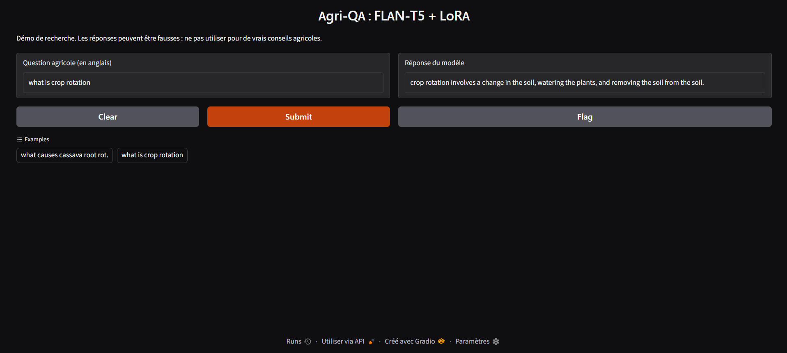
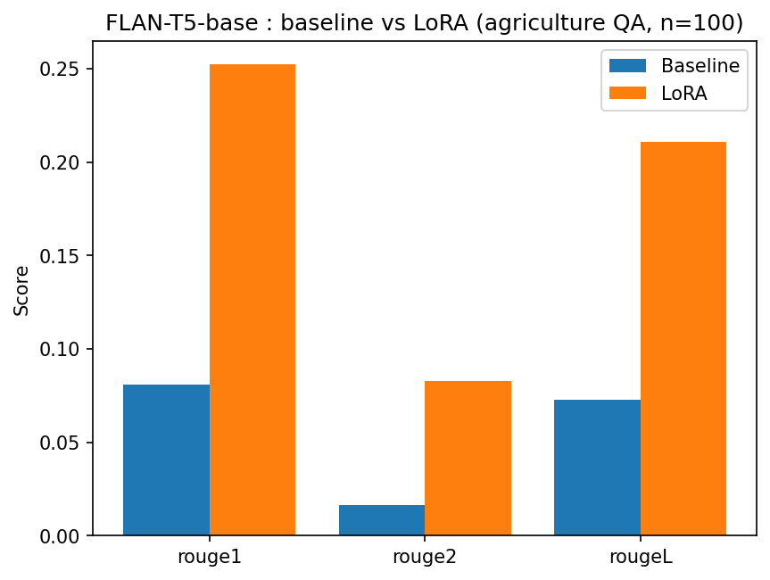

agri-llm: Parameter-efficient fine-tuning of FLAN-T5 for agricultural Q&A
Hands-on project built while following the Coursera course Generative AI with Large Language Models (AWS / DeepLearning.AI). It covers the project lifecycle taught in the course: prompting baseline, parameter-efficient fine-tuning (LoRA), evaluation, and a small demo.
The work has two parts:
Validation on DialogSum (dialogue summarization) to check the pipeline end to end.
Adaptation to agriculture (question answering) on a public dataset.

Method
Model: `google/flan-t5-base` (about 249M parameters)
Fine-tuning: LoRA with Hugging Face PEFT (`r=16`, `alpha=32`, dropout 0.05, target modules `q` and `v`). Only 1,769,472 parameters (0.71 %) are trained.
Evaluation: ROUGE (1, 2, L, Lsum) with stemming, comparing the zero-shot baseline to the LoRA model on the same held-out examples.
Tools: PyTorch, Transformers, PEFT, Datasets, Evaluate, Gradio. Training on a free Colab T4 GPU.
Part 2: Agricultural Q&A
Dataset: `KisanVaani/agriculture-qa-english-only` (22,615 rows with `question` and `answers` columns). License: [to check on the dataset page before publishing].
Preparation
Duplicate questions removed: 22,615 → 2,225 unique questions, to avoid the same question appearing in both train and test.
Split (seed 42): 2,002 train / 111 validation / 112 test.
Prompt: `Answer the following agricultural question.\n\nQuestion: {q}\n\nAnswer:`
Training: 3 epochs, learning rate 1e-3, batch size 8, about 3.5 minutes on a T4.
Epoch	Training loss	Validation loss
1	2.830	2.375
2	2.673	2.283
3	2.583	2.247
Validation loss decreases with training loss and is still falling at epoch 3, so more epochs could help.
Results (first 100 test examples, same for both models)
Metric	Zero-shot baseline	LoRA	Gain
ROUGE-1	0.0807	0.2521	×3.1
ROUGE-2	0.0165	0.0828	×5.0
ROUGE-L	0.0726	0.2107	×2.9
ROUGE-Lsum	0.0725	0.2104	×2.9

Error analysis
The baseline answers with one or two words ("fungi", "a syringe") while references are full sentences. After LoRA the model writes complete, fluent answers, but several problems remain:
Wrong content: for "how can you break chemical dormancy", the model suggests a fungicide, while the reference describes leaching the seed or a temperature/light regime.
Invented details: "root rot in the leaves" for cassava root rot.
Repetition: on some questions the output loops ("a fungicide such as a fungicide such as ...") and redundant phrasing appears ("soil structure, soil fertility, and soil structure").
Metric limit: ROUGE measures word overlap, not factual correctness. A fluent but false answer can score well.
Part 1: Pipeline validation on DialogSum
Same pipeline on `knkarthick/dialogsum` (2,000 training examples, 1 epoch, 50 test examples).
Metric	Zero-shot baseline	LoRA
ROUGE-1	0.2155	0.3728
ROUGE-2	0.0439	0.1063
ROUGE-L	0.1760	0.2895
ROUGE-Lsum	0.1758	0.2893
Repository structure
```
agri-llm/
├── notebooks/   # DialogSum baseline and LoRA; agriculture Q&A (02_agri_qa_lora.ipynb)
├── results/     # ROUGE scores (JSON), comparison chart, demo screenshot
├── models/      # LoRA adapter for the agriculture model (zip)
├── app/         # Gradio demo (app.py)
└── README.md
```
Run the demo
Unzip `models/lora-agri-adapter.zip` into `models/lora-agri-adapter/`.
Install dependencies and launch:
```bash
pip install torch transformers peft gradio
python app/app.py
```
The demo runs on CPU if no GPU is available. It uses `no_repeat_ngram_size=3` to limit repetition loops; this option was not used for the ROUGE scores above.
Limitations
Small evaluation sets (100 examples for agriculture, 50 for DialogSum) and a single run with one random seed: the numbers are indicative, not statistically robust.
After deduplication the agricultural training set is small (2,002 examples), and answer length varies a lot, which makes ROUGE less stable.
English only; the model can produce incorrect agronomic statements. This is a research demo and must not be used for real agricultural advice.
No human evaluation of factual accuracy.
Possible next steps
More epochs and hyperparameter search on the validation set.
Larger base model or a RAG system grounded in trusted agronomy documents to reduce hallucinations.
Additional metrics (BERTScore) and manual review of factual accuracy.
Acknowledgments
Course: Generative AI with Large Language Models (AWS and DeepLearning.AI, Coursera). Datasets: DialogSum and KisanVaani/agriculture-qa-english-only (see their pages for licenses).
